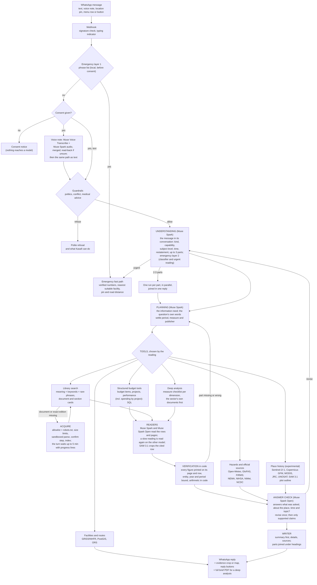

# Kasafi

**Ask Sokoto State's public budgets, reports, forecasts and flood record anything, by Hausa voice note or text on
WhatsApp, and get an answer checked against its source page.**

| Try it | |
| --- | --- |
| **WhatsApp:** [wa.me/2348039539665](https://wa.me/2348039539665) (username **@kasafibyhnq**). The first message gets a short consent notice: reply *OK* or *Na yarda*. |  |
| **Demo video (3 min):** https://youtu.be/l5p5kypJkoU *(link to be confirmed at submission)* | |

Messages that work on the live service today (4 Nov 2026; each was run on the server this week, the first and the
Hausa ones at every deploy by [`scripts/live_smoke.py`](scripts/live_smoke.py)):

1. *How much is allocated to the Ministry of Health in the 2026 budget?*
2. *How many schools are in Dange Shuni?*
3. *According to MICS 2021, what share of children under 5 in Sokoto have their birth registered, and what is the
   national figure?*
4. Share your location, then: *I'm thinking of moving my family here. What is the government spending in this
   area, has it ever flooded, and where's the nearest clinic?* (one message, three tools, one reply)
5. *What's the state of PHCs in Sokoto?* (a deep analysis; reply *full brief* for the PDF)

In Hausa:

1. *Nawa aka ware wa ilimi a kasafin 2026?* (How much was allocated to education in the 2026 budget?)
2. *Kai wanene?* (Who are you?)
3. *zaɓi* (the menu), or a voice note: *"Nawa aka ware wa Ma'aikatar Lafiya a 2026?"*

Kasafi is a WhatsApp agent for people in Sokoto State, Nigeria. You send it a Hausa voice note or a text message
in Hausa or English, and it answers from public sources: the state's budgets and budget performance reports,
policies and plans, development-partner reports, official weather and flood outlooks, the health facility
registry, and, as an experiment, the satellite record of a farm or a ward. Every figure in an answer comes from a
cited page or table and is checked in code before it is sent. When a document Kasafi needs isn't in its library,
it looks for it on government and partner sites, fetches it, indexes it and then answers. Kasafi gives neutral
facts only: no opinions on politics, nothing about conflict or security operations, and no medical advice.

> Entry by Halal Numeriq Limited (Startups track) in the **Meta Global AI Developer Hackathon** (Oct 26 – Nov 4,
> 2026). Problem statement: *Build for Your World*.

## Three journeys

**A farmer worried about flooding.** Hauwa shares her farm's location and asks by voice, "Shin ruwa ya taɓa rufe
gonata?" (Has my farm ever flooded?). Kasafi tries to draw the plot from a satellite image. If it can't, it asks
how big the farm is, or for its corners. It then answers in Hausa from the satellite record. The UN's satellite
flood maps come first, with their dates. Radar comes next, labelled as a lower bound. If no water was seen, the
answer says so and explains why a flood could still have been missed. It never says "never flooded". A chart and
a map follow. Hauwa then asks "and what's budgeted for irrigation here?" and gets her LGA's budget lines. If no
line names her LGA, she gets the statewide totals that may cover it.

**A citizen checking a service budget by voice.** Musa sends a voice note: "Nawa aka ware wa Ma'aikatar Lafiya a
2026?" (How much was budgeted for the Ministry of Health in 2026?). Kasafi reads back what it heard when it isn't
sure. It answers in a few plain sentences with the source page. It sends a cropped image of the printed row. If
Musa replies *nuna lissafi* (show working), he gets the rows and the arithmetic. He can also ask what had been
spent by the end of the last quarter, against the revised budget.

**A partner assessing an LGA.** A programme officer asks which wards of Wurno LGA were greenest in 2024, which
LGAs the 2022 floods covered most, and which 2026 capital projects are located in Wurno. Kasafi answers with a
ward map and a ranking, then the project lines tagged to the LGA. Statewide lines are counted separately and said
to be so. A question that names a publisher, such as "according to IOM, how many IDPs are in Sokoto?", is answered
from that publisher's own documents.

## What works today (4 Nov 2026)

Checked against the deployed release `d40b8e1`, live since the evening of 4 Nov 2026 (Lagos time); `/version` on
the server returns the serving commit. "Live" means on that release; each row is a capability this release serves,
not a measurement of accuracy in the field (see *Results* for those).

| Capability | Status |
| --- | --- |
| Budget and budget-performance answers, typed or by Hausa voice note, with citations, evidence crops and *show working* | Live |
| **Conversation understanding** before any route: one small Muse Spark call reads the message with the last four turns and the place on file (kind, capability, subject level, time, a restatement), so follow-ups, corrections and "here" mean what the user meant | Live |
| **Multi-part questions**: one message asking two or three different things is split into parts, each answered by its own tool in parallel (budget, flood record, nearest facility…), and joined in one reply with a heading per part and each part's crops, maps and pins | Live (switch `KASAFI_MULTI_PART`) |
| **Voice notes through the same pipeline as text**: two transcripts merged, a read-back when unsure, then exactly the text path (understanding, multi-part, every tool); answered in the language spoken | Live |
| WhatsApp interface: an interactive **menu** (list), the **location request button**, **reply buttons** under answers (Show working, Full brief (PDF), Send location, Hausa / English), and a **typing indicator** kept on while an answer is written | Live |
| **Answer check** before sending: Muse Spark Open reads every draft against the question, the conversation, the cited pages and the code checks; one revise round; then only what the pages support | Live (switch `KASAFI_ANSWER_CHECK`) |
| **Live document fetching by exact edition**: a missing report named with its period ("Budget Implementation Report Q4 2025") is found on allowlisted sites, downloaded, indexed with its tables and answered from in the same turn; another edition never stands in for it | Live |
| Word documents (DOCX, DOC, ODT, RTF) in the library, converted to PDF and indexed like any PDF | Live |
| Questions that need several publishers (IDPs, poverty, employment), answered side by side | Live |
| Charts on text pages read once at index time by **Muse Spark Open**; document and section cards so a question finds a document its title doesn't name | Live: 116 documents, 413 chart regions |
| **Deep analysis** of broad questions ("What's the state of PHCs in Sokoto?"): a measure checklist per dimension, ten or more documents read in parallel (the sector's own first), every figure checked against its page, one neutral synthesis, a message per dimension, the full brief as a **PDF** | Live |
| **NEMA flood situation reports and dashboards** (2024–2025): people affected, displaced, houses and farmland, by date | Live: 10 reports |
| Weather, air quality, river and fire answers with a map; official advisories and outlooks (NEMA, NIHSA, NiMet); NCDC outbreak figures | Live |
| Nearest health facility, route and road distance; corrections about a listed facility checked by road | Live |
| **Two-layer emergency detection**: a local phrase list fires before consent; after consent a Muse Spark classifier and the understanding step catch emergencies the phrases miss; the reply gives verified numbers and the nearest suitable facility first | Live |
| Scope guardrails (politics, security, medical advice, land ownership) | Live |
| **Place history** for a farm pin, a ward, an LGA or the state: Sentinel-2 greenness and water, Sentinel-1 radar floods, the Copernicus GFM flood record 2015–2026, UNOSAT flood maps, a farm's outline drawn by **SAM 3.1**; a change map for floods, greenness and drought | Experimental: live, and labelled so in every answer |
| **Meta credit guard**: spend per hour and provider is recorded; when the recorded Meta balance minus spend drops under $10, or the API refuses for billing, Muse Spark text calls switch to Muse Spark Open and the admin pages say so | Live |
| Hazard alerts people sign up for (one approved WhatsApp template) | Dry run: decisions go to the admin page, not to users |
| Spoken (audio) replies | Planned: replies are text and images only |

## How Meta's models are used

| Model | What it does | Where |
| --- | --- | --- |
| **Muse Spark** (Meta Model API) | Reads each message in its conversation (understanding). Plans each question and fills its information need. Reads budget rows (first reading). Writes page-based answers and the deep-analysis synthesis. Reads the first documents of a deep analysis. Reads scanned pages (OCR). Reconciles the two transcripts of a voice note. Classifies borderline guardrail and emergency messages. Answers messages about Kasafi itself. | [`app/agent/understand.py`](app/agent/understand.py), [`app/agent/answer.py`](app/agent/answer.py) (`plan_question`, `compose`), [`app/agent/line_answer.py`](app/agent/line_answer.py), [`app/agent/deep.py`](app/agent/deep.py), [`app/retrieval/ocr.py`](app/retrieval/ocr.py), [`app/providers/stt.py`](app/providers/stt.py), [`app/guardrails/scope.py`](app/guardrails/scope.py), [`app/guardrails/emergency.py`](app/guardrails/emergency.py); client [`app/providers/meta.py`](app/providers/meta.py) |
| **Muse Spark Open** (open weights, served by Fireworks since 4 Nov; Baseten until its credit ran out) | The answer check on every draft. The second, independent reading of every budget-line answer. The second-opinion plan when the question's own words conflict. The later readings of a deep analysis. Reads charts on text pages (image input) and writes the document and section cards at index time. Every eval run and batch job (bulk import, the overnight loop). The fallback for Muse Spark when the credit guard trips. | [`app/agent/answer_check.py`](app/agent/answer_check.py), `_second_reading` in [`app/agent/line_answer.py`](app/agent/line_answer.py), [`app/agent/deep.py`](app/agent/deep.py), [`app/retrieval/chart_read.py`](app/retrieval/chart_read.py), [`app/retrieval/cards.py`](app/retrieval/cards.py), [`app/spend.py`](app/spend.py); hosts chosen in [`app/providers/fireworks.py`](app/providers/fireworks.py) (`KASAFI_OPEN_HOSTS`) |
| **Muse Voice Transcribe** | One of two transcripts of each voice note; Muse Spark's audio reading is the other. | [`app/providers/stt.py`](app/providers/stt.py), [`app/whatsapp/voice.py`](app/whatsapp/voice.py) |
| **SAM 3.1** (Meta Model API) | Crops the cited table row from the source page as evidence. Draws a farm's outline from a Sentinel-2 image. | [`app/evidence/crops.py`](app/evidence/crops.py), [`app/place/outline.py`](app/place/outline.py); client [`app/providers/sam.py`](app/providers/sam.py) |

## Architecture

The pipeline for a message: understanding, planning, tools, readers, verification in code, the answer check, the
writer.



Design details: [`docs/architecture.md`](docs/architecture.md), [`docs/routing.md`](docs/routing.md),
[`docs/hazard-and-services.md`](docs/hazard-and-services.md), [`docs/place-history.md`](docs/place-history.md).

## What makes it agentic, not basic RAG

Basic RAG fetches some text and asks a model to answer from it. Kasafi decides what to do at each step, checks the
result in code and acts on a failed check. Five examples from the code:

1. **Understanding, planning and routing.** Muse Spark first reads the message in its conversation
   ([`app/agent/understand.py`](app/agent/understand.py)): a follow-up keeps its subject, "X not Y" excludes Y,
   "here" is the area around the pin and "my farm" is the plot. It then plans the question: what is asked, for
   which entity, level and period. Code reads the question's own words in English and Hausa (the period, spent or
   approved, the publisher named) and overrides the plan where they are clear
   ([`app/agent/words.py`](app/agent/words.py)). The reading decides the tool: the structured budget tools, the
   library search, hazards, facilities, place history or a deep analysis; missed phrasings are fixed in the
   reading and added as test cases, never as keywords. The routing set of 88 questions that carry another
   feature's words is checked in code at 0 wrong ([`evals/routing/`](evals/routing)).
2. **Several tools for one message.** "What is the government spending in this area, has it ever flooded, and
   where's the nearest clinic?" is read as three parts. Each runs through its own tool in parallel with the shared
   pin and language; the reply joins them in the order asked, each with its own crops, map or pin; a part that
   fails gets one honest line and the others are still sent
   ([`app/whatsapp/conversation.py`](app/whatsapp/conversation.py)).
3. **Fetching the documents it is missing.** When the plan needs a document the library doesn't hold,
   `find_and_fetch` ([`app/acquisition/library.py`](app/acquisition/library.py)) reads the series and exact period
   from the description, tries the known address, publisher listings and allowlisted search; downloads with a
   check on every redirect; parses in a separate, resource-limited process; confirms it is the right document and
   edition; indexes it with its URL, hash and date; and answers the original question in the same turn. The next
   user gets it from the library.
4. **Deep analysis with a measure checklist.** A broad question ("What's the state of PHCs in Sokoto?") is split
   into dimensions, each with the measures a neutral analyst would look for: facility counts and needs, staff
   available and required by cadre, the PHC agency's allocation, share and actual spending per year, coverage
   from the surveys' Sokoto tables, EmONC capability, plan targets ([`app/agent/deep.py`](app/agent/deep.py)).
   The sector's own plans and assessments are read before budgets; budget figures come from the budget and
   implementation-report rows in code. A measure still missing gets its own search, twice, before it is reported
   as not found, and a document that couldn't be read in time is named, never dropped in silence.
5. **Verification, the answer check and redo.** Every figure in a draft answer is looked up on its cited page and
   bound to its row's entity, year and period ([`app/agent/attribution.py`](app/agent/attribution.py)); a figure
   that isn't printed and wasn't calculated in code is dropped. For a budget-line question, Muse Spark and Muse
   Spark Open pick rows independently and code answers only from the rows both chose
   ([`app/agent/line_answer.py`](app/agent/line_answer.py)). Before sending, Muse Spark Open checks the draft
   against the question ([`app/agent/answer_check.py`](app/agent/answer_check.py)); a "revise" verdict runs one
   more round, with the message read again when the draft was about the wrong subject.

## Data sources and use

Kasafi answers only from public documents and public data.

| Source | Used for | Terms and credit |
| --- | --- | --- |
| Sokoto State budgets, implementation reports, appropriation laws, plans and policies; development-partner and survey reports (MICS, NDHS, NBS, SBS) | Document answers, deep analyses | Public documents, cited by document and page; used for reference only |
| Sokoto State Ministry of Finance site (mof.sk.gov.ng) | Bulk import of its public document listing | Public listing only (no login), robots.txt honoured, one request a second |
| NEMA flood situation reports and dashboards, 2024–2025 | People affected, displaced, houses and farmland, by date | Official source, cited with the report's date; contact-list pages withheld |
| GRID3 Nigeria / NHFR facility registry (Nov 2024) | Facility counts, nearest facility | Credited "GRID3 Nigeria / NHFR"; licence not yet confirmed, so the file is kept out of git |
| OCHA COD-AB boundaries, GRID3 wards | LGAs and wards | Credited on maps |
| Open-Meteo (weather, air quality, rain archive) | Hazard answers, place history rainfall | Free tier for non-commercial use within its daily limits; a paid key is planned |
| GloFAS river discharge (Copernicus Emergency Management Service) | River flood outlook | Labelled as a model estimate; official outlooks lead |
| NASA FIRMS (VIIRS) | Fire hotspots | Free MAP_KEY; called "satellite heat detections" |
| NEMA, SEMA, NIHSA, NiMet, NCDC | Official advisories, outlooks, outbreak figures | Official sources, cited with their dates |
| IOM DTM | Displacement figures | Through IOM's public API |
| Sentinel-2 and Sentinel-1 (Copernicus), MODIS, ESA WorldCover | Place history | Read through the Planetary Computer data API |
| Copernicus Global Flood Monitoring (GFM) | The flood record of every season 2015–2026 | From its public STAC catalogue; quoted beside UNOSAT, never averaged with it |
| JRC Global Surface Water | Water history and the water-body layer | Credited on the answer |
| UNOSAT flood extents (via HDX) | Official flood maps for 2022 and 2024 | CC BY-SA, credited |
| OpenStreetMap | Base map roads, rivers, water-body names | "© OpenStreetMap contributors" |
| OpenRouteService | Road distance and directions | Free key within its limits |

- **Fetching rules.** Only https links on an allowlist of government and partner domains are fetched
  ([`app/acquisition/policy.py`](app/acquisition/policy.py)); other domains wait for a person to approve them on
  `/admin/review`. Every request identifies itself as `KasafiBot/1.0` and checks robots.txt; a site whose
  robots.txt says `ai-input=no` is refused.
- **Minimal excerpts.** Each model call gets only what its step needs: a few page excerpts for an answer, the first
  pages of a fetched document, one page image at a time for OCR, the band of the page around a cited row for
  SAM 3.1.
- **Personal data in public documents.** Pages that list people with phone numbers, NIN/BVN, account numbers or
  salaries are withheld: the document is indexed, but those pages are never searched, quoted or cropped
  ([`app/acquisition/personal.py`](app/acquisition/personal.py)).
- **Excluded content.** Documents about conflict, security operations or banditry, and partisan political
  material, are not indexed. Budget figures for security lines are answered as plain cited figures.

## How answers are checked

- **The words settle what they can.** Before the planner's plan is used, code reads the question's own words in
  English, Hausa and code-switched forms: the period (and so the report), spent vs approved vs revised, the splits
  named, the publishers named, and a named budget line. A clear match overrides the plan. When the words conflict,
  a second plan from Muse Spark Open decides. Every override is recorded in the trace
  ([`app/agent/words.py`](app/agent/words.py), [`docs/planner-variance.md`](docs/planner-variance.md)).
- **Two readings.** For a budget-line question, Muse Spark and Muse Spark Open each pick the rows that answer it,
  independently and at the same time. Code answers only from the rows both chose, and shows the others as
  "possibly relevant, not counted".
- **Code does the arithmetic.** Totals, differences, shares, rankings and project status are SQL over the
  structured budget tables built at indexing time, not model arithmetic. Totals of counts (schools at each level)
  are added in code from parts checked in the place's own row, and only parts the document counts separately.
- **Figures are checked against their rows.** On the page-based path, each figure in the answer is looked up in
  the cited rows and checked against the row's entity, the year and quarter period of its own column, its unit and
  its kind (allocation or spending). A contradiction (another entity's or another column's figure) is rewritten
  once and refused if still wrong. *Attribution checked* is given only when the row settles the entity, year and
  period; when the evidence can't settle one of them, the answer says *figures checked* instead. This is a
  rule-based check of the cited text, not a full semantic verification. The state is shown in *show working* and
  on the admin trace ([`app/agent/attribution.py`](app/agent/attribution.py)).
- **Entity, level and period** of the rows used are compared with what was asked; a mismatch is redone once and
  then said plainly ([`app/agent/consistency.py`](app/agent/consistency.py)).
- **An answer check before sending.** Every answer (document, place, hazard, deep analysis, and a "not found") is
  read by Muse Spark Open against the question, the last four turns, the restatement, the cited pages and the code
  checks: does it answer what was asked, about the exact place, time and topic, and is each figure on a cited page?
  Code rules sit above the model: an answer whose figures appear on none of the cited pages, or a Yes/No about a
  different subject, can never pass. A "revise" verdict buys one more round (the message is read again when the
  subject was wrong); if that still fails, code keeps only the supported claims, states what was left out in one
  plain sentence, and keeps the maps and crops that belong to the claims kept. The checker never writes
  user-facing text. On a replay of 44 drafts it stopped all 6 bad live answers and sent back 4 of 38 right ones
  (11%, just over our 10% bar), at a median 2.1 s and $0.0064 a check
  ([`app/agent/answer_check.py`](app/agent/answer_check.py), [`report-open.md`](evals/check/report-open.md)). When
  the check's own call times out (30 s), the answer is sent unchecked by the model, with the code checks only,
  and the trace says "skipped".
- **An answer or an apology.** The answer function has a 180-second limit (5 minutes when the turn is fetching a
  document, with a progress line every 45 seconds); past it the user gets an apology, or, for a fetch, the answer
  on its own as soon as the report is indexed. The checked text is sent as soon as it is ready. Maps follow under
  their own 30-second limit (or a note says the map couldn't be drawn), and evidence crops under a 45-second one.
  A failure is logged with its reason on the admin page. Incoming messages are not yet persisted before
  processing, so a job lost to a server restart is not recovered (roadmap).

## How we evaluate

- **Generated sets from the data.** Each run draws about 50 fresh budget questions from the extracted tables:
  lookups, splits, quarterly spending, comparisons, rankings, false premises and questions with no answer in the
  data. Each is asked in a template form or a paraphrase: Hausa, informal, code-switched, with typos, or as a
  follow-up. A reply is wrong when an expected figure is missing, a wrong agency is named, or a false premise isn't
  corrected ([`evals/generated/`](evals/generated)).
- **Fixed sets:** multi-publisher topic questions ([`evals/topics/`](evals/topics)), answer patterns found in phone
  tests ([`evals/patterns/`](evals/patterns)), the scope guardrails in Hausa and English
  ([`evals/guardrails/`](evals/guardrails)), the emergency fast path ([`evals/emergency/`](evals/emergency)),
  conversation understanding ([`evals/understanding/`](evals/understanding)), place history for wards and LGAs
  with expected values from the precomputed table ([`evals/place/`](evals/place)), survey and statistics questions
  with expected values read from the report pages ([`evals/surveys/`](evals/surveys)), new documents and prose
  figures ([`evals/newdocs/`](evals/newdocs), [`evals/prose/`](evals/prose)), a routing set checked in code
  ([`evals/routing/`](evals/routing)), and **every failure found on the phone**, kept with the user's exact
  wording ([`evals/live_failures/`](evals/live_failures)).
- **Conversations end to end.** Scripted WhatsApp conversations run through the real webhook handler before every
  deploy ([`tests/test_e2e_conversation.py`](tests/test_e2e_conversation.py)), with the unit suite (2,364 tests at
  this commit); every deploy then runs live messages on the server through the real webhook path
  ([`scripts/live_smoke.py`](scripts/live_smoke.py)).
- **An overnight improvement loop** ([`evals/overnight/`](evals/overnight), rules in
  [`RULES.md`](evals/overnight/RULES.md), results in [`docs/overnight-report.md`](docs/overnight-report.md)). Each
  round generates about 100 questions across every feature, with expected answers computed by code from the
  structured data or confirmed on the cited page (a model only rephrases), split 50/50 into a fix half and a
  held-out half. Failures are grouped by cause and fixed with general changes only (no keywords, no
  question-specific rules); a fix is kept only if the held-out half improves or stays the same and the
  live-failure, routing and understanding sets don't get worse, one commit per fix with its before/after scores.
  Questions are never edited to pass. The night of 3–4 Nov ran two rounds on Muse Spark Open and kept 13 fixes for
  $19.29 on Baseten and $0 on the Meta API.

### Results

Every number below is from a report in this repository; the date and the model each ran on are given. These are
results on our own test sets, not a general accuracy figure. Several sets move between runs of the same code
(the writer sometimes drops a sentence, and a slow host pushes answers past their time limit), so ranges are given
where they moved, and the weak sets are listed as they are.

| Set | Cases | Result | Run on | Source |
| --- | --- | --- | --- | --- |
| Conversation understanding | 78 | **78** right | 3 Nov, Muse Spark (Meta Model API); median 3.5 s, $0.0026 a message | [`report.md`](evals/understanding/report.md) |
| Conversation understanding, with the 4 Nov cases (multi-part, area vs farm) | 121 | **121** right | 4 Nov, Muse Spark Open (Fireworks); median 2.3 s | [`report-open.md`](evals/understanding/report-open.md) |
| Routing (in code, no model) | 88 | **88** right | 4 Nov | [`report.md`](evals/routing/report.md) |
| Emergency fast path: must fire / must stay quiet | 64 / 64 | **64 / 64**; the phrase list alone fired 44 of 64; off-list set 20/20 with 0 false alarms of 20 | 2 Nov, phrase list, then the Muse Spark classifier and the understanding step | [`report.md`](evals/emergency/report.md) |
| Scope guardrails, Hausa and English | 104 | **104** right | 1 Nov, Muse Spark on borderline cases | [`report.md`](evals/guardrails/report.md) |
| Answer check replay: bad live drafts stopped / right drafts wrongly sent back | 6 / 38 | **6 of 6** stopped; **4 of 38** sent back (11%; our bar was under 10%) | 3 Nov, Muse Spark Open | [`report-open.md`](evals/check/report-open.md) |
| Place history, full live path | 103 | **95** (79–80 on the releases before) | 4 Nov early hours, Muse Spark Open (Baseten) | [overnight report](docs/overnight-report.md) |
| Survey and statistics questions | 23 | **22** on `main`; 19 in the overnight run, three of whose misses passed on rerun. One case (s18, a two-survey comparison) is wrong on every version | 4 Nov, Muse Spark Open | [`report.md`](evals/surveys/report.md), [overnight report](docs/overnight-report.md) |
| New documents | 12 | **8** (the same four wrong before and after the overnight fixes) | 4 Nov early hours, Muse Spark Open (Baseten) | [overnight report](docs/overnight-report.md) |
| Prose figures (a number in a sentence, not a table) | 7 | **1** (1–2 on the releases before). Our weakest set: most take a budget-table route or a clarification instead of the report's sentence | 4 Nov early hours, Muse Spark Open (Baseten) | [overnight report](docs/overnight-report.md) |
| Live phone failures, English and Hausa | 13 | **11** on 3 Nov; 11–13 over three overnight runs of the same code; **7** on 4 Nov on Fireworks, where answers took 2–3 times longer and several ran out of time | 3–4 Nov, Muse Spark Open (Baseten, then Fireworks) | [`report.md`](evals/live_failures/report.md), [overnight report](docs/overnight-report.md), [`report-fireworks-1104.md`](evals/live_failures/report-fireworks-1104.md) |
| Overnight generated questions, held-out halves | 48, then 37 | round 1: 41 → **45**; round 2: 34 → **34**. Weakest features across rounds: NEMA report figures 7/12, multi-turn school questions 4/10, surveys 9/12 | 4 Nov early hours, Muse Spark Open (Baseten) | [overnight report](docs/overnight-report.md) |
| Deep analysis | – | No fixed set of its own: 5 of 6 deep questions right in the overnight loop; one live regression on 4 Nov is kept as the live-failure case `lfPHC` | – | [overnight report](docs/overnight-report.md), [lesson L44](docs/extraction-lessons.md) |

Older sets last run before the 1 Nov deploy and not rerun since: fresh budget draw
[`report-predeploy-review2.md`](evals/generated/report-predeploy-review2.md) (52 cases, 0 wrong), topics
[`report-predeploy-review.md`](evals/topics/report-predeploy-review.md) (0 wrong of 12), place history through the
pipeline [`report-full.md`](evals/place/report-full.md) (89 cases, 0 wrong), flip cases
[`report.md`](evals/variance/report.md) (0 flips).

## What we learned about Meta's models

Findings from this week, each from a report, a config note or a design note in this repository.

1. **Reading by meaning caught emergencies a phrase list missed.** Our Hausa and English phrase list alone fired
   on 44 of 64 real emergency messages. With a Muse Spark classifier (median 1.75 s) and the understanding step
   reading the meaning ("matata na naƙuda", my wife is in labour), 64 of 64 fired, with no false alarm on the
   20 off-list messages that must stay quiet ([`evals/emergency/report.md`](evals/emergency/report.md)). The
   phrase list stays as layer 1 because it needs no model and works before consent.
2. **No single model was reliable on Hausa voice notes, but two were.** Muse Voice Transcribe doesn't list Hausa.
   On 16 of our own voice notes neither it nor Muse Spark's audio input was reliable alone, so both run in
   parallel and one Muse Spark call reconciles them, with a read-back when they disagree on a year, number or
   place. The merge once dropped a phrase the guardrails needed, with high confidence, in 3 of 4 tries, so the
   guardrails read the raw transcripts too ([`docs/architecture.md`](docs/architecture.md),
   [`evals/stt-hausa-2026-10-26.md`](evals/stt-hausa-2026-10-26.md)).
3. **Minimal reasoning needs token headroom.** At minimal effort with a 900-token limit, one message ("Where can
   I take my sick child?") used 898 tokens on reasoning and returned nothing; with 1,600 the same call finishes at
   500–900. Minimal effort read 45 of 45 conversations right at a median 2.7 s and $0.0020 a message; low effort
   with 3,000 tokens read 44 of 45 at 4.9 s and $0.0049, so more reasoning was slower and no more reliable
   ([`app/config.py`](app/config.py), [`evals/understanding/`](evals/understanding)).
4. **Muse Spark Open always reasons, and its token limit counts the reasoning.** Calls written for Muse Spark
   (400–3,000 tokens) came back empty on Open. Every batch call now gets at least 8,000 tokens and low effort
   ([`app/providers/fireworks.py`](app/providers/fireworks.py)).
5. **Which model for which step is an empirical question, and the host changes the answer.** On our 39-question
   set, composing on Muse Spark Open had 0 wrong and was faster (median 2.9 s vs 6.2 s on Muse Spark), while
   planning on Open missed a ranking query 2 times in 3 against about 1 in 5 on Muse Spark, so planning stayed on
   Muse Spark. After Baseten's credit ran out and Open moved to Fireworks, the same compose step took 22.7 s
   against 6.8 and 18.2 s on Muse Spark, so it moved back ([`app/config.py`](app/config.py)).
6. **Open weights made bulk reading and evals affordable.** Importing 57 documents cost $7.57, cards for every
   document $9.07, 345 chart regions $2.50, and the overnight improvement loop $19.29, all on Muse Spark Open with
   $0 on the Meta API for the loop; the Meta credit went to live users and the demo (the status log in
   [`CLAUDE.md`](CLAUDE.md), [`docs/overnight-report.md`](docs/overnight-report.md)).
7. **Two models that disagree are a useful check; one model checking another needs measuring.** For budget lines,
   code answers only from the rows Muse Spark and Muse Spark Open both chose. As the answer checker, Open stopped
   6 of 6 bad live answers but also sent back 4 of 38 right ones, so its verdict buys one more round rather than
   a refusal, and code rules sit above it ([`evals/check/report-open.md`](evals/check/report-open.md)).
8. **Latency and timeouts decide what a user sees.** When the Open readers of a deep analysis slowed down on
   Fireworks, they ran past their deadline and were dropped: the same question that gave 23 checked claims in
   42 s on 2 Nov gave 9 in 154 s on 4 Nov, and reported real figures as "not found". The first readings now go
   to the live model, a slow reading is read again on the other model, and a document nobody read is named in the
   reply ([lesson L44](docs/extraction-lessons.md)).

## Safety and privacy

Short version: Kasafi asks for consent before anything reaches a model, never stores phone numbers, keeps a
shared location in memory for 30 minutes and stores only the LGA, and deletes your data on request (*DELETE MY
DATA*). The full policy is at **https://halalnumeriq.com.ng/kasafi/privacy**.

- **Consent first.** No message reaches any model until the user accepts the first-contact notice
  ([`app/whatsapp/conversation.py`](app/whatsapp/conversation.py)). The notice says that Meta's free-credit API
  usage may be used to improve Meta's products. Deleting your data and the emergency path work before consent.
- **No numbers stored.** Users are keyed by a keyed hash of their number. Phone numbers and WhatsApp names never
  reach a model. Alert subscribers' numbers are the one exception: they are stored encrypted, only to send the
  alert, and deleted on STOP or DELETE MY DATA.
- **Locations.** A shared location stays in the server's memory for at most 30 minutes; only the LGA is stored.
  A plot outline, a farm size given as a circle and corner pins also stay in memory only. The database keeps
  satellite statistics for 100 m cells, with no link to any user. The source of the privacy page is in
  [`docs/site/privacy.md`](docs/site/privacy.md).
- **Documents are data.** Fetching is limited to https sites on an allowlist and respects robots.txt and
  Content-Signals. Downloads have a size limit. PDFs are parsed in a separate resource-limited subprocess (time
  and memory limits; not an isolation sandbox). Text inside a document is never followed as an instruction.
- **Scope.** Politics, conflict and security operations, and medical or nutrition advice are declined politely,
  in Hausa or English. Budget figures for security agencies are given as plain cited figures. Place history
  reports what the images show and refers farmers to the state's agricultural extension service. It refuses land
  ownership, boundary and certificate questions.

## Known limitations

- **Hazard alerts are in dry run.** Sign-ups work and decisions are made, but they go to the admin page, not to
  users, until the template and a per-recipient delivery record are ready.
- **Place history is experimental.** It has not been validated in the field. Radar misses water under crops, the
  UN flood maps are coarse (375 m), and a first-time pin takes one to two minutes.
- **A live fetch of a large report can take more than two minutes.** The turn waits up to five minutes with
  progress lines; past that, the answer is sent on its own when the report is indexed.
- **The answer check is skipped when its provider times out** (30 s). The answer then goes out with the code
  checks only, and the trace records the skip.
- **Hausa answers sometimes come back in English**, or with English labels inside a Hausa answer. A typed message
  is answered in the saved language, a voice note in the language spoken; the model-written parts don't always
  follow.
- **Speed depends on the Open-weights host.** Since Baseten's credit ran out (4 Nov), Muse Spark Open runs on
  Fireworks, where the same steps were 2–3 times slower that day; several live-failure cases then ran out of
  time.
- **Prose figures are weak** (1 of 7 on our set): a number that only appears in a sentence, not a table, is often
  missed or sent to a budget table instead.
- **Two-source comparisons can miss a page.** One survey case (MICS and NDHS birth registration) reads the wrong
  MICS pages on every version.
- **Multi-part readings vary.** The flood part of a three-part question is occasionally read at plot level
  instead of the area; a budget part has no page crop; an uncertain voice note still gets a read-back first.
- **Spending by project exists for two sectors only.** The implementation reports give capital spending by
  project for primary healthcare and basic education; other sectors are by ministry, and budget lines are matched
  to those rows only by agency code and exact description, so most lines have no project-level spending.
- **The NEMA figures and multi-turn school questions** were the weakest features in the overnight sets (7/12 and
  4/10).
- **Ward names come from the GRID3/INEC boundary file** and may be shorter than local usage ("Bado" for
  Bado/Kasarawa).
- Replies are text and images; there are no spoken replies yet.
- Incoming messages are not persisted before processing, so a job lost to a server restart is not recovered.
  Backups stay on the server for now; off-host copies and a restore rehearsal are planned.
- Weather and rainfall come from Open-Meteo's free non-commercial tier, to be moved to a paid key.
- An external review of the code was done on 1 Nov. Each finding and our response (done, planned or not accepted,
  with reasons) is in [the review document](docs/reviews/2026-11-01-external-review.md#response-to-the-external-review-bilyaminu-bawan-allah--kasafi-1-nov-2026).
- Design notes: [`docs/architecture.md`](docs/architecture.md), [`docs/hazard-and-services.md`](docs/hazard-and-services.md),
  [`docs/place-history.md`](docs/place-history.md), and every document-extraction problem fixed so far with its
  regression test, in [`docs/extraction-lessons.md`](docs/extraction-lessons.md).

## Built during the hackathon

Everything in this repository was written during the hackathon, Oct 26 – Nov 4, 2026. The git history is the
record; by day:

- **Oct 26:** the project skeleton, the Meta Model API client, and the Hausa voice-note test harness.
- **Oct 27:** the WhatsApp webhook, the two-transcript voice pipeline with read-back and corrections, consent and
  per-user limits, guardrails, the privacy pages, the deploy with rollback, the PDF indexer, OCR of scanned pages,
  and grounded answers with figure checks.
- **Oct 28:** fetching missing documents safely (allowlist, robots.txt, size limits, provenance), recency-aware
  search, follow-up context, Kasafi's own calculations, evidence crops with SAM 3.1, and budget queries in code.
- **Oct 29:** searchable budget lines and the two independent readings with Muse Spark Open, the structured
  budget core and its analysis tools, the admin trace and review pages, the source registry, and multi-source
  topic answers.
- **Oct 30:** the information need in the plan, the capability catalogue and the plan → act → check loop,
  generated evals, IOM's displacement API, PostGIS boundaries and facilities, location intake, the emergency fast
  path, hazard layers and the official advisories crawl.
- **Oct 31:** server-drawn maps, facility routing and corrections, hazard summaries written in code, hazard alerts
  in dry run, a speed round, and place history steps 1 and 2 (the satellite record of a pin, the SAM 3.1 plot
  outline, and radar and UN flood maps).
- **Nov 1:** place history for wards, LGAs and the state, plot shapes from the farmer, the water-body layer, fixes
  for planner variance, the end-to-end conversation tests, the external review round, the admin status page, and
  Word documents in the library.
- **Nov 2:** document and section cards, charts on text pages, the bulk import of the Ministry of Finance site,
  deep analysis with a PDF brief, budgets for the user's own area, and conversation understanding before every
  route.
- **Nov 3:** the flood record from Copernicus GFM and the change map, NEMA flood reports, the answer check,
  reading wide with totals in code, follow-ups that keep their subject, and the Meta credit guard.
- **Nov 4:** the overnight improvement loop (13 fixes), multi-part questions, voice notes through the text
  pipeline, Fireworks replacing Baseten, spending-by-project tables, live fetching by exact edition with the
  answer in the same turn, and the deep-analysis reader fixes.

## Pre-existing assets

Assets created before the hackathon and reused here. No code is reused.

- Public Sokoto State budget, policy and partner documents, listed in [`data/manifest.json`](data/manifest.json)
  with their source URLs.
- No Hausa glossary was reused. The test questions in [`evals/`](evals) were written during the hackathon.

An earlier, separate Kasafi prototype was built for a different competition. No code from it is used here. On
Oct 30 we read that prototype's public technical notes for ideas only, and re-implemented these on this
project's own extraction and database: budget tables as entities with one column per year and measure, reconciled
at extraction time; a project's status from one budget's own previous-year columns; only LGA-tagged projects for
an LGA, with statewide ones counted apart; counts kept apart from money; every figure labelled as allocated or
spent; and a short plain answer with the working sent separately.

## Setup

Requires Python 3.12, [uv](https://docs.astral.sh/uv/), Docker and FFmpeg.

```bash
cp .env.example .env              # fill in values; never commit .env
uv sync                           # install dependencies into .venv
docker compose up -d db           # local Postgres 17 with pgvector and PostGIS
uv run alembic upgrade head
uv run uvicorn app.main:app --reload
uv run pytest
python scripts/fetch_seed_docs.py # download the seed documents into data/
```

Deploying to the server: [`deploy/README.md`](deploy/README.md). WhatsApp setup:
[`docs/whatsapp-setup.md`](docs/whatsapp-setup.md).

## License

[MIT](LICENSE)
