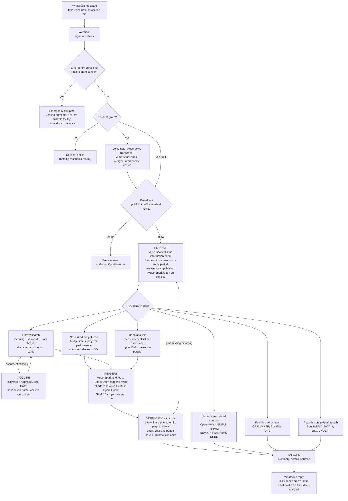

# Kasafi

Kasafi is a WhatsApp agent for people in Sokoto State, Nigeria. You send it a Hausa voice note or a text message
in Hausa or English, and it answers from public sources: the state's budgets and budget performance reports,
policies and plans, development-partner reports, official weather and flood outlooks, the health facility
registry, and, as an experiment, the satellite record of a farm or a ward. Every figure in an answer comes from a
cited page or table and is checked in code before it is sent. When a document Kasafi needs isn't in its library,
it looks for it on government and partner sites, fetches it, indexes it and then answers. Kasafi gives neutral
facts only: no opinions on politics, nothing about conflict or security operations, and no medical advice.

> Entry by Halal Numeriq Limited (Startups track) in the **Meta Global AI Developer Hackathon** (Oct 26 – Nov 4,
> 2026). Problem statement: *Build for Your World*.

## Three journeys

**A farmer worried about flooding.** Hauwa shares her farm's location and asks by voice, "Shin ruwa ya taɓa rufe
gonata?" (Has my farm ever flooded?). Kasafi tries to draw the plot from a satellite image. If it can't, it asks
how big the farm is, or for its corners. It then answers in Hausa from the satellite record. The UN's satellite
flood maps come first, with their dates. Radar comes next, labelled as a lower bound. If no water was seen, the
answer says so and explains why a flood could still have been missed. It never says "never flooded". A chart and
a map follow. Hauwa then asks "and what's budgeted for irrigation here?" and gets her LGA's budget lines. If no
line names her LGA, she gets the statewide totals that may cover it.

**A citizen checking a service budget by voice.** Musa sends a voice note: "Nawa aka ware wa Ma'aikatar Lafiya a
2026?" (How much was budgeted for the Ministry of Health in 2026?). Kasafi reads back what it heard when it isn't
sure. It answers in a few plain sentences with the source page. It sends a cropped image of the printed row. If
Musa replies *nuna lissafi* (show working), he gets the rows and the arithmetic. He can also ask what had been
spent by the end of the last quarter, against the revised budget.

**A partner assessing an LGA.** A programme officer asks which wards of Wurno LGA were greenest in 2024, which
LGAs the 2022 floods covered most, and which 2026 capital projects are located in Wurno. Kasafi answers with a
ward map and a ranking, then the project lines tagged to the LGA. Statewide lines are counted separately and said
to be so. A question that names a publisher, such as "according to IOM, how many IDPs are in Sokoto?", is answered
from that publisher's own documents.

## What works today (1 Nov 2026)

Checked against the deployed release `ca5d5ee`, live since 1 Nov 2026 (evening, Lagos time); `/version` on the
server returns the serving commit. "Live" below means on that release, through the pre-deploy gate (see *How we
evaluate*); each row is a capability this release serves, not a measurement of accuracy in the field.

| Capability | Status |
| --- | --- |
| Budget and budget-performance answers, typed or by Hausa voice note, with citations, evidence crops and *show working* | Live |
| Finding, fetching and indexing a missing document from allowlisted sites | Live |
| Word documents (DOCX, DOC, ODT, RTF) in the library, converted to PDF with LibreOffice and indexed like any PDF; citations say the pages are the converted PDF's | Live |
| Questions that need several publishers (IDPs, poverty, employment), answered side by side | Live |
| Charts on text pages (bar, line, pie and table-like figures) read once at index time by **Muse Spark Open**: values printed as labels are answerable figures ("read from Figure N on page P", with the chart's crop as evidence); values only drawn as bar heights are never given as numbers | Live: 345 chart regions in the library |
| Document and section cards (what each document and section covers, its places, years and measures), written by **Muse Spark Open**, so a question finds a document its title doesn't name; related documents linked | Live: all 49 documents |
| Deep analysis of broad questions ("What's the state of PHCs in Sokoto?"): dimensions planned, up to 15 documents read in parallel, every figure checked against its page, one neutral synthesis, a message per dimension, the full brief as a PDF | Live |
| Weather, air quality, river and fire answers with a map; official advisories and outlooks (NEMA, NIHSA, NiMet); NCDC outbreak figures | Live |
| Nearest health facility, route and road distance | Live |
| Emergency fast path (verified numbers and the nearest suitable facility, before anything else) | Live |
| Scope guardrails (politics, security, medical advice, land ownership) | Live |
| Hazard alerts people sign up for (one approved WhatsApp template) | Dry run: decisions go to the admin page, not to users |
| Place history for a farm pin, a ward, an LGA or the state (satellite greenness, water, floods, bare soil) | Experimental: live, and labelled so in every answer |
| Spoken (audio) replies | Planned: replies are text and images only |

## How Meta's models are used

| Model | What it does | Where |
| --- | --- | --- |
| **Muse Spark** (Meta Model API) | Plans each question and fills its information need. Reads budget rows (first reading). Writes page-based answers. Reads scanned pages (OCR). Reconciles the two transcripts of a voice note. Classifies borderline guardrail and emergency messages. | [`app/agent/answer.py`](app/agent/answer.py) (`plan_question`, `compose`), [`app/agent/line_answer.py`](app/agent/line_answer.py), [`app/retrieval/ocr.py`](app/retrieval/ocr.py), [`app/providers/stt.py`](app/providers/stt.py), [`app/guardrails/scope.py`](app/guardrails/scope.py), [`app/guardrails/emergency.py`](app/guardrails/emergency.py); client [`app/providers/meta.py`](app/providers/meta.py) |
| **Muse Spark Open** (open weights, Baseten; Fireworks as fallback host) | The second, independent reading of every budget-line answer. The second-opinion plan when the question's own words conflict. Reads charts on text pages (image input) at index time. Writes the document and section cards. Plans a deep analysis's dimensions and reads its documents. | `read_chart` in [`app/retrieval/chart_read.py`](app/retrieval/chart_read.py), [`app/retrieval/cards.py`](app/retrieval/cards.py), [`app/agent/deep.py`](app/agent/deep.py); | `_second_reading` in [`app/agent/line_answer.py`](app/agent/line_answer.py), `open_reader` and `settle_by_words` in [`app/agent/answer.py`](app/agent/answer.py); clients [`app/providers/baseten.py`](app/providers/baseten.py), [`app/providers/fireworks.py`](app/providers/fireworks.py) |
| **Muse Voice Transcribe** | One of two transcripts of each voice note; Muse Spark's audio reading is the other. | [`app/providers/stt.py`](app/providers/stt.py), [`app/whatsapp/voice.py`](app/whatsapp/voice.py) |
| **SAM 3.1** (Meta Model API) | Crops the cited table row from the source page as evidence. Draws a farm's outline from a satellite image. | [`app/evidence/crops.py`](app/evidence/crops.py), [`app/place/outline.py`](app/place/outline.py); client [`app/providers/sam.py`](app/providers/sam.py) |

## Architecture



Design details: [`docs/architecture.md`](docs/architecture.md), [`docs/hazard-and-services.md`](docs/hazard-and-services.md),
[`docs/place-history.md`](docs/place-history.md), [`docs/routing.md`](docs/routing.md).

## What makes it agentic, not basic RAG

Basic RAG fetches some text and asks a model to answer from it. Kasafi decides what to do at each step, checks the
result in code and acts on a failed check. Four examples from the code:

1. **Planning and routing.** Muse Spark plans each question: what is asked, for which entity, level and period,
   and which capabilities can answer it. Code then reads the question's own words in English and Hausa (the
   period, spent or approved, the publisher named) and overrides the plan where they are clear
   ([`app/agent/words.py`](app/agent/words.py)); when they conflict, Muse Spark Open gives a second plan. A routing
   rule in code sends each question to the structured budget tools, the library search, hazards, facilities,
   place history or a deep analysis ([`app/agent/routing.py`](app/agent/routing.py)). The routing set of 88
   questions that carry another feature's words is checked in code at 0 wrong ([`evals/routing/`](evals/routing)).
2. **Fetching the documents it is missing.** When the plan needs a document the library doesn't hold,
   `find_and_fetch` ([`app/acquisition/library.py`](app/acquisition/library.py)) tries the publisher's own address,
   publisher listings and allowlisted search; downloads with a check on every redirect; parses in a separate,
   resource-limited process; confirms it is the right document and edition; indexes it with its URL, hash and date;
   and answers. The next user gets it from the library.
3. **Deep analysis with a measure checklist.** A broad question ("What's the state of PHCs in Sokoto?") is split
   into dimensions, each with the measures a neutral analyst would look for: facility counts and needs, staff
   available and required by cadre, the PHC agency's allocation, share and actual spending per year, coverage
   from the surveys' Sokoto tables, EmONC capability, plan targets ([`app/agent/deep.py`](app/agent/deep.py)).
   Muse Spark Open reads up to 15 documents in parallel; budget figures come from the budget and implementation
   report rows in code. A measure still missing gets its own search, twice, before it is reported as not found.
   Claims are ranked (gaps, targets, trends and shares before single items), and one Muse Spark call writes the
   summary from the checked claims only.
4. **Verification and redo.** Every figure in a draft answer is looked up on its cited page and bound to its row's
   entity, year and period ([`app/agent/attribution.py`](app/agent/attribution.py)); a figure that isn't printed
   and wasn't calculated in code is dropped. For a budget-line question, Muse Spark and Muse Spark Open pick rows
   independently and code answers only from the rows both chose
   ([`app/agent/line_answer.py`](app/agent/line_answer.py)). If a part of the question was not answered for the
   entity, level and period asked, the plan is redone once with that part named
   ([`app/agent/completeness.py`](app/agent/completeness.py)); anything still missing is said in the reply.

## Data sources and use

Kasafi answers only from public documents and public data.

| Source | Used for | Terms and credit |
| --- | --- | --- |
| Sokoto State budgets, implementation reports, appropriation laws, plans and policies; development-partner and survey reports (MICS, NDHS, NBS, SBS) | Document answers, deep analyses | Public documents, cited by document and page; used for reference only |
| Sokoto State Ministry of Finance site (mof.sk.gov.ng) | Bulk import of its public document listing | Public listing only (no login), robots.txt honoured, one request a second |
| GRID3 Nigeria / NHFR facility registry (Nov 2024) | Facility counts, nearest facility | Credited "GRID3 Nigeria / NHFR"; licence not yet confirmed, so the file is kept out of git |
| OCHA COD-AB boundaries, GRID3 wards | LGAs and wards | Credited on maps |
| Open-Meteo (weather, air quality, rain archive) | Hazard answers, place history rainfall | Free tier for non-commercial use within its daily limits; a paid key is planned |
| GloFAS river discharge (Copernicus Emergency Management Service) | River flood outlook | Labelled as a model estimate; official outlooks lead |
| NASA FIRMS (VIIRS) | Fire hotspots | Free MAP_KEY; called "satellite heat detections" |
| NEMA, SEMA, NIHSA, NiMet, NCDC | Official advisories, outlooks, outbreak figures | Official sources, cited with their dates |
| IOM DTM | Displacement figures | Through IOM's public API |
| Sentinel-2 and Sentinel-1 (Copernicus), MODIS, ESA WorldCover | Place history | Read through the Planetary Computer data API |
| JRC Global Surface Water | Water history and the water-body layer | Credited on the answer |
| UNOSAT flood extents (via HDX) | Official flood maps for 2022 and 2024 | CC BY-SA, credited |
| OpenStreetMap | Base map roads, rivers, water-body names | "© OpenStreetMap contributors" |
| OpenRouteService | Road distance and directions | Free key within its limits |

- **Fetching rules.** Only https links on an allowlist of government and partner domains are fetched
  ([`app/acquisition/policy.py`](app/acquisition/policy.py)); other domains wait for a person to approve them on
  `/admin/review`. Every request identifies itself as `KasafiBot/1.0` and checks robots.txt; a site whose
  robots.txt says `ai-input=no` is refused.
- **Minimal excerpts.** Each model call gets only what its step needs: a few page excerpts for an answer, the first
  pages of a fetched document, one page image at a time for OCR, the band of the page around a cited row for
  SAM 3.1.
- **Personal data in public documents.** Pages that list people with phone numbers, NIN/BVN, account numbers or
  salaries are withheld: the document is indexed, but those pages are never searched, quoted or cropped
  ([`app/acquisition/personal.py`](app/acquisition/personal.py)).
- **Excluded content.** Documents about conflict, security operations or banditry, and partisan political
  material, are not indexed. Budget figures for security lines are answered as plain cited figures.

## How answers are checked

- **The words settle what they can.** Before the planner's plan is used, code reads the question's own words in
  English, Hausa and code-switched forms: the period (and so the report), spent vs approved vs revised, the splits
  named, the publishers named, and a named budget line. A clear match overrides the plan. When the words conflict,
  a second plan from Muse Spark Open decides. Every override is recorded in the trace
  ([`app/agent/words.py`](app/agent/words.py), [`docs/planner-variance.md`](docs/planner-variance.md)).
- **Two readings.** For a budget-line question, Muse Spark and Muse Spark Open each pick the rows that answer it,
  independently and at the same time. Code answers only from the rows both chose, and shows the others as
  "possibly relevant, not counted".
- **Code does the arithmetic.** Totals, differences, shares, rankings and project status are SQL over the
  structured budget tables built at indexing time, not model arithmetic.
- **Figures are checked against their rows.** On the page-based path, each figure in the answer is looked up in
  the cited rows and checked against the row's entity, the year and quarter period of its own column, its unit and
  its kind (allocation or spending). A contradiction (another entity's or another column's figure) is rewritten
  once and refused if still wrong. *Attribution checked* is given only when the row settles the entity, year and
  period; when the evidence can't settle one of them (a table with two year columns and no label on the cell, or
  one shared word like "Education" with two Education rows), the answer says *figures checked* instead. This is a
  rule-based check of the cited text, not a full semantic verification. The state is shown in *show working* and
  on the admin trace ([`app/agent/attribution.py`](app/agent/attribution.py)).
- **Entity, level and period** of the rows used are compared with what was asked; a mismatch is redone once and
  then said plainly ([`app/agent/consistency.py`](app/agent/consistency.py)).
- **An answer check before sending.** Every answer (document, place, hazard, deep analysis, and a "not found") is
  read by Muse Spark Open against the question, the last four turns, the restatement, the cited pages and the code
  checks: does it answer what was asked, about the exact place, time and topic, and is each figure on a cited page?
  Code rules sit above the model: an answer whose figures appear on none of the cited pages, or a Yes/No about a
  different subject, can never pass. A "revise" verdict buys one more round (the message is read again when the
  subject was wrong); if that still fails, code keeps only the supported claims, states what was left out in one
  plain line, and keeps the maps and crops that belong to the claims kept. The checker never writes user-facing
  text. On a replay of 43 drafts it stopped all 6 bad live answers and sent back 3 of 37 right ones (8%), at about
  2.3 s and $0.0065 a check ([`app/agent/answer_check.py`](app/agent/answer_check.py), [`evals/check/`](evals/check)).
- **An answer or an apology.** While the server is running, the answer function has a 120-second limit; past it
  the user gets an apology, and nothing from that job can be sent afterwards. The checked text is sent as soon as it
  is ready. Maps follow under their own 30-second limit (or a note says the map couldn't be drawn), and evidence
  crops under a 45-second one. A failure is logged with its reason on the admin page. Incoming messages are not yet
  persisted before processing, so a job lost to a server restart is not recovered (roadmap).

## How we evaluate

- **Generated sets from the data.** Each run draws about 50 fresh budget questions from the extracted tables:
  lookups, splits, quarterly spending, comparisons, rankings, false premises and questions with no answer in the
  data. Each is asked in a template form or a paraphrase: Hausa, informal, code-switched, with typos, or as a
  follow-up. A reply is wrong when an expected figure is missing, a wrong agency is named, or a false premise isn't
  corrected ([`evals/generated/`](evals/generated)).
- **Fixed sets:** multi-publisher topic questions ([`evals/topics/`](evals/topics)), answer patterns found in phone
  tests ([`evals/patterns/`](evals/patterns)), official advisories, the scope guardrails in Hausa and English
  ([`evals/guardrails/`](evals/guardrails)), place history for wards and LGAs with expected values from the
  precomputed table ([`evals/place/`](evals/place)), the questions that once flipped between runs
  ([`evals/variance/`](evals/variance)), survey and statistics questions (MICS 2021, NDHS 2024, the NBS and SBS
  MPI reports) with expected values read from the report pages ([`evals/surveys/`](evals/surveys)), and a routing
  set of questions that carry another feature's words, checked in code against the route each must take
  ([`evals/routing/`](evals/routing), [`docs/routing.md`](docs/routing.md)).
- **Conversations end to end.** Scripted WhatsApp conversations run through the real webhook handler against a
  test database before every deploy. Each scripted message must get exactly the expected replies, never silence
  and never a duplicate ([`tests/test_e2e_conversation.py`](tests/test_e2e_conversation.py)).
- **A held-out set** of questions is kept outside this repository, so that it can't shape the code. It is run
  before the final submission, with the same checks.
- **An overnight improvement loop** ([`evals/overnight/`](evals/overnight), rules in
  [`RULES.md`](evals/overnight/RULES.md), results in [`docs/overnight-report.md`](docs/overnight-report.md)). Each
  round generates about 100 questions across every feature, with expected answers computed by code from the
  structured data or confirmed on the cited page (a model only rephrases), split 50/50 into a fix half and a held-out
  half. Failures are grouped by cause and fixed with general changes only (no keywords, no question-specific rules); a
  fix is kept only if the held-out half improves or stays the same and the live-failure, routing and understanding
  sets don't get worse, one commit per fix with its before/after scores. Questions are never edited to pass. The
  night of 3–4 Nov ran two rounds on Muse Spark Open (held-out 41/48 → 45/48, then 34/37 → 34/37) and kept 13
  fixes for $19.29 on Baseten and $0 on the Meta API.

### Results

Measured on the code now on `main` (the overnight branch at `3137cda`, merged as `cd29d4a`) against the release
deployed before it (`a7836ff`, with `3e4e58b` and `8eedd7f` where that commit itself wasn't rerun). All runs are on
Muse Spark Open through the full live path; the eval harness refuses Meta calls. These are results on these test
sets, not a general accuracy figure, and some sets move between runs of the same code (the writer sometimes drops a
sentence), so the range of the runs is given where it moved.

| Set | Cases | Deployed before | This code | Note |
| --- | --- | --- | --- | --- |
| Place history, full live path ([`evals/place/`](evals/place)) | 103 | 79–80 | **95** | The rain, flood and water ward rankings now reach the satellite record and keep their maps. Still wrong: eight ward-scope wording and ranking cases. |
| Survey and statistics questions ([`report.md`](evals/surveys/report.md)) | 23 | 21 | 19 overnight, **22** on the merged `main` (4 Nov) | The overnight misses s05, s07 and s09 passed on reruns (variance). s18, a two-survey comparison of birth registration, is wrong on every version: the MICS Sokoto row (p. 337) isn't among the pages read. |
| New documents ([`evals/newdocs/`](evals/newdocs)) | 12 | 8 | 8 | The same four cases wrong on both. |
| Prose figures ([`evals/prose/`](evals/prose)) | 7 | 1–2 | 1 | p05 flips between runs on both versions; the others take a budget-table route or a clarification instead of the report's sentence, or don't find it. Not improved by the overnight loop. |
| Live phone failures, English and Hausa ([`evals/live_failures/`](evals/live_failures)) | 13 | 11 | 11–13 over three runs of the same code | No case fails on every run; the writer sometimes omits the state-level IQS line or the total sentence. |
| Routing (in code, [`evals/routing/`](evals/routing)) | 88 | 88 | 88 | |
| Conversation understanding ([`report.md`](evals/understanding/report.md)) | 78 | 78 | 78 | Last live run on Muse Spark, 3 Nov; the recorded readings replay through the handler in the test suite on both versions. |

Older sets last run before the 1 Nov deploy and not rerun since: fresh budget draw
[`report-predeploy-review2.md`](evals/generated/report-predeploy-review2.md) (52 cases, 0 wrong), topics
[`report-predeploy-review.md`](evals/topics/report-predeploy-review.md) (0 wrong of 12), guardrails
[`report.md`](evals/guardrails/report.md) (104 of 104), flip cases [`report.md`](evals/variance/report.md) (0 flips).

## Safety and privacy

- **Consent first.** No message reaches any model until the user accepts the first-contact notice
  ([`app/whatsapp/conversation.py`](app/whatsapp/conversation.py)). The notice says that Meta's free-credit API
  usage may be used to improve Meta's products. Deleting your data and the emergency path work before consent.
- **No numbers stored.** Users are keyed by a keyed hash of their number. Phone numbers and WhatsApp names never
  reach a model. Alert subscribers' numbers are the one exception: they are stored encrypted, only to send the
  alert, and deleted on STOP or DELETE MY DATA.
- **Locations.** A shared location stays in the server's memory for at most 30 minutes; only the LGA is stored.
  A plot outline, a farm size given as a circle and corner pins also stay in memory only. The database keeps
  satellite statistics for 100 m cells, with no link to any user. Full details are on the
  [privacy page](docs/site/privacy.md).
- **Documents are data.** Fetching is limited to https sites on an allowlist and respects robots.txt and
  Content-Signals. Downloads have a size limit. PDFs are parsed in a separate resource-limited subprocess (time
  and memory limits; not an isolation sandbox). Text inside a document is never followed as an instruction.
- **Scope.** Politics, conflict and security operations, and medical or nutrition advice are declined politely,
  in Hausa or English. Budget figures for security agencies are given as plain cited figures. Place history
  reports what the images show and refers farmers to the state's agricultural extension service. It refuses land
  ownership, boundary and certificate questions.

## Known limitations and roadmap

- Replies are text and images; there are no spoken replies yet.
- Hazard alerts are in dry run until the template and the delivery tracking are ready. A per-recipient outbox
  with delivery callbacks is planned.
- Place history is experimental. It has not been validated in the field. Radar misses water under crops, and the
  UN flood maps are coarse (375 m).
- Weather and rainfall come from Open-Meteo's free non-commercial tier, to be moved to a paid key.
- Backups stay on the server for now. Off-host copies and a restore rehearsal are planned.
- An external review of the code was done on 1 Nov. Each finding and our response (done, planned or not accepted,
  with reasons) is in [the review document](docs/reviews/2026-11-01-external-review.md#response-to-the-external-review-bilyaminu-bawan-allah--kasafi-1-nov-2026).
- Design notes: [`docs/architecture.md`](docs/architecture.md), [`docs/hazard-and-services.md`](docs/hazard-and-services.md),
  [`docs/place-history.md`](docs/place-history.md), and every document-extraction problem fixed so far with its
  regression test, in [`docs/extraction-lessons.md`](docs/extraction-lessons.md).

## Built during the hackathon

Everything in this repository was written during the hackathon, Oct 26 – Nov 4, 2026. The git history is the
record; by day:

- **Oct 26:** the project skeleton, the Meta Model API client, and the Hausa voice-note test harness.
- **Oct 27:** the WhatsApp webhook, the two-transcript voice pipeline with read-back and corrections, consent and
  per-user limits, guardrails, the privacy pages, the deploy with rollback, the PDF indexer, OCR of scanned pages,
  and grounded answers with figure checks.
- **Oct 28:** fetching missing documents safely (allowlist, robots.txt, size limits, provenance), recency-aware
  search, follow-up context, Kasafi's own calculations, evidence crops with SAM 3.1, and budget queries in code.
- **Oct 29:** searchable budget lines and the two independent readings with Muse Spark Open, the structured
  budget core and its analysis tools, the admin trace and review pages, the source registry, and multi-source
  topic answers.
- **Oct 30:** the information need in the plan, the capability catalogue and the plan → act → check loop,
  generated evals, IOM's displacement API, PostGIS boundaries and facilities, location intake, the emergency fast
  path, hazard layers and the official advisories crawl.
- **Oct 31:** server-drawn maps, facility routing and corrections, hazard summaries written in code, hazard alerts
  in dry run, a speed round, and place history steps 1 and 2 (the satellite record of a pin, the SAM 3.1 plot
  outline, and radar and UN flood maps).
- **Nov 1:** place history for wards, LGAs and the state, plot shapes from the farmer, the water-body layer, fixes
  for planner variance, the end-to-end conversation tests, the external review round, and the admin status page.

## Pre-existing assets

Assets created before the hackathon and reused here. No code is reused.

- Public Sokoto State budget, policy and partner documents, listed in [`data/manifest.json`](data/manifest.json)
  with their source URLs.
- No Hausa glossary was reused. The test questions in [`evals/`](evals) were written during the hackathon.

An earlier, separate Kasafi prototype was built for a different competition. No code from it is used here. On
Oct 30 we read that prototype's public technical notes for ideas only, and re-implemented these on this
project's own extraction and database: budget tables as entities with one column per year and measure, reconciled
at extraction time; a project's status from one budget's own previous-year columns; only LGA-tagged projects for
an LGA, with statewide ones counted apart; counts kept apart from money; every figure labelled as allocated or
spent; and a short plain answer with the working sent separately.

## Setup

Requires Python 3.12, [uv](https://docs.astral.sh/uv/), Docker and FFmpeg.

```bash
cp .env.example .env              # fill in values; never commit .env
uv sync                           # install dependencies into .venv
docker compose up -d db           # local Postgres 17 with pgvector and PostGIS
uv run alembic upgrade head
uv run uvicorn app.main:app --reload
uv run pytest
python scripts/fetch_seed_docs.py # download the seed documents into data/
```

Deploying to the server: [`deploy/README.md`](deploy/README.md). WhatsApp setup:
[`docs/whatsapp-setup.md`](docs/whatsapp-setup.md).

## License

[MIT](LICENSE)
