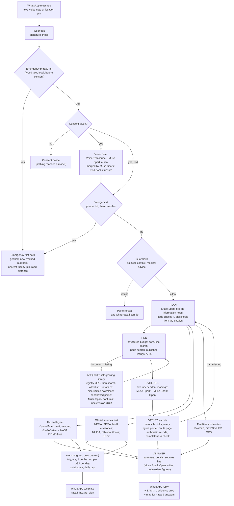

# Kasafi

Kasafi is a WhatsApp agent for people in Sokoto State, Nigeria. It works in Hausa first, with English as a fallback, and it accepts voice notes as well as text. The people it serves are citizens (many of whom read little English or prefer to speak), civil servants and development partners. They all need figures that are locked inside long English PDFs: state budgets, budget performance reports, development plans, and reports from NBS, UNICEF, the World Bank, IOM and others. Finding one number usually means opening several of these documents and reading their tables. Kasafi takes the question, plans which documents and tools it needs, and fetches and indexes any document it doesn't have yet from trusted sites. Two models read the evidence separately. Code then checks every figure against the printed page. The reply is short and in the user's language, cites the document and page for each claim, and attaches a cropped image of the source row. Kasafi also answers questions about hazards: heat, dust, rain, river levels, outbreaks and fires, with official warnings first. It can name the nearest health facility, and it has a fast path for emergencies.

> Entry by Halal Numeriq Limited (Startups track) in the **Meta Global AI Developer Hackathon** (Oct 26 – Nov 4, 2026). Problem statement: *Build for Your World*. Privacy policy: [halalnumeriq.com.ng/kasafi](https://halalnumeriq.com.ng/kasafi).

## How Meta's models are used

All four Meta models are in the live path. Each has its own job.

| Model | What it does in Kasafi | Files that call it |
|---|---|---|
| **Muse Spark** (`muse-spark-1.3`, Meta Model API) | **Planner.** One call rewrites the message into a standalone question and fills a structured "information need": measures, entities, place, period and operation. Code then checks every field against fixed lists and the budgets' own names (`need.py`) and picks tools from `data/catalog.yaml`. Muse Spark also gives the **first reading** of budget rows, checks fetched documents, merges the two speech transcripts, runs the guardrail and emergency classifiers on borderline messages, and does the completeness check. | [`app/agent/answer.py`](app/agent/answer.py) (`plan_question`), [`app/agent/need.py`](app/agent/need.py), [`app/agent/line_answer.py`](app/agent/line_answer.py) (`_read_once`), [`app/acquisition/library.py`](app/acquisition/library.py) (`confirm_document`), [`app/agent/completeness.py`](app/agent/completeness.py), [`app/guardrails/scope.py`](app/guardrails/scope.py), [`app/guardrails/emergency.py`](app/guardrails/emergency.py), [`app/providers/meta.py`](app/providers/meta.py) |
| **Muse Spark vision** (image input) | Reads pages that are **pictures of tables**: scanned budgets, NCDC situation reports, and UNHCR dashboards that print state figures only on a map. The page text it returns is still number-checked by code like any other page. | [`app/retrieval/ocr.py`](app/retrieval/ocr.py), [`app/hazards/advisories.py`](app/hazards/advisories.py), [`app/agent/topics.py`](app/agent/topics.py) |
| **Muse Spark Open** (`meta-models/muse-spark-open-1026`, open weights on Baseten; Fireworks as fallback host) | The **second, independent reading** of budget rows, run at the same time as the first. It also does **answer writing** (the `compose` stage, `KASAFI_OPEN_STAGES`). If Open errors or is slow, Muse Spark takes over, so Baseten never blocks a reply. | [`app/agent/line_answer.py`](app/agent/line_answer.py) (`_second_reading`), [`app/agent/answer.py`](app/agent/answer.py) (`open_reader`, `compose`), [`app/providers/baseten.py`](app/providers/baseten.py), [`app/providers/fireworks.py`](app/providers/fireworks.py) |
| **Muse Voice Transcribe** (`muse-voice-transcribe-1.0`) | Hausa voice notes. Hausa isn't on its language list, and on our own notes no single model was reliable. So Voice Transcribe and Muse Spark audio run in parallel, and Muse Spark merges the two. When the merge isn't sure, Kasafi reads the question back ("Kana nufin …?") before searching. | [`app/providers/stt.py`](app/providers/stt.py), [`app/providers/audio.py`](app/providers/audio.py), [`app/whatsapp/voice.py`](app/whatsapp/voice.py) |
| **SAM 3.1** (`sam-3.1`, Meta Model API) | **Evidence crops.** The cited row is first found on the rendered page, inside the sandbox. A SAM 3.1 box prompt then tightens it to the table or row, and the figure is highlighted. The image goes out on WhatsApp after the text. | [`app/providers/sam.py`](app/providers/sam.py), [`app/evidence/crops.py`](app/evidence/crops.py) |

**Why two different models read the same rows.** For a budget-line question, search returns about 40 printed rows. Muse Spark and Muse Spark Open each pick the rows that answer the question, independently and at the same time. Code then compares the two picks (`reconcile` in `line_answer.py`):
- Rows both models chose are answered and added up by code.
- Rows only one model chose are shown as "possibly relevant, not counted".
- If the picks share nothing, Kasafi asks the user which item they meant.

The admin trace page shows both readings side by side. Measured on Oct 29, using the same 39 questions and the same code:

| | Reading 2 on Muse Spark Open | Both readings on Muse Spark |
|---|---|---|
| answered / partial / not found / clarify | **18 / 13 / 6 / 2** | 16 / 17 / 6 / 0 |
| Median time per question | 14.0 s | 13.8 s |
| Open reading time (35 readings) | median 3.4 s, max 6.7 s | – |
| Fallbacks to Muse Spark | 0 | – |

Reports: [`mid_tier_report_step13_open.md`](evals/complex/mid_tier_report_step13_open.md) and [`mid_tier_report_step13_meta.md`](evals/complex/mid_tier_report_step13_meta.md).

On Oct 30, answer writing moved to Muse Spark Open as well. On the 39 questions this gave 0 wrong answers in both configurations, and Meta API spend per answer fell from $0.0276 to $0.0127 (commit `20d82bc`). The planner stays on Muse Spark: on Open it missed one ranking question 2 times out of 3.

## Architecture



- **Budget documents** become three entity tables when they are indexed: `budget_items`, `projects` and `perf_items` ([`app/retrieval/entities.py`](app/retrieval/entities.py)). Reconciliation checks run at every build, for example that each ministry's personnel + overhead + debt + capital adds up to its printed total: 1,038 of 1,038 ministries pass on the 2026 budget. The analysis tools then do every count and sum in SQL ([`app/agent/analysis.py`](app/agent/analysis.py)).
- **Topic questions** that no single document answers, such as "the current state of IDPs" or "unemployment", draw on 3–5 publishers from [`data/source_registry.yaml`](data/source_registry.yaml). The model copies each figure onto a fact card. Code keeps a card only if its value is printed on the cited page, then writes the side-by-side reply ([`app/agent/topics.py`](app/agent/topics.py)).
- **Hazards** are planner capabilities ([`app/hazards/`](app/hazards/)). Their summaries are written in code ([`app/hazards/summary.py`](app/hazards/summary.py)), and one map is drawn on our own server ([`app/maps/render.py`](app/maps/render.py)).
- **Status:** document answers, hazard layers, official advisories, facilities and routing, maps and the emergency fast path are live. Alerts are built and tested but switched off (`KASAFI_ALERTS` unset; dry run by default). Replies are text for now.

Design details: [`docs/architecture.md`](docs/architecture.md), [`docs/hazard-and-services.md`](docs/hazard-and-services.md), [`docs/extraction-lessons.md`](docs/extraction-lessons.md).

## What makes it agentic, not basic RAG

Basic RAG retrieves some chunks and asks a model to answer from them. Kasafi makes decisions along the way: which tools to use, which documents it is missing, whether a fetched file is the right one, whether two readings agree, and whether every part of the question was answered. When a check fails, it acts on that. Three examples from the code:

1. **It goes and gets documents it doesn't have.** When the planner names a document that isn't in the library, `find_and_fetch` ([`app/acquisition/library.py`](app/acquisition/library.py)) works through these steps:
   - It tries the publisher's own address from the source registry, then publisher listings (NBS e-library, Sokoto State Bureau of Statistics, UNHCR), then the World Bank and ReliefWeb APIs, then web search limited to allowlisted domains ([`app/acquisition/find.py`](app/acquisition/find.py)).
   - It downloads with a check on every redirect hop ([`app/acquisition/fetch.py`](app/acquisition/fetch.py)) and parses the PDF in a separate limited process ([`app/acquisition/sandbox.py`](app/acquisition/sandbox.py)).
   - Muse Spark reads the first pages (`confirm_document`) to decide whether this is the right document and edition, and whether it should be excluded.
   - If it is, Kasafi indexes the document with its URL, SHA-256 hash and fetch date, and answers. The next user gets it straight from the library.
   - If not, the gap goes to the human review queue.
2. **Two models read the evidence, and code decides.** `read_lines` ([`app/agent/line_answer.py`](app/agent/line_answer.py)) runs Muse Spark and Muse Spark Open at the same time on the same rows, and `reconcile` compares their picks.
   - `verify` then checks every row ID the models gave and every number in the draft answer against the printed rows. A number that isn't printed, and wasn't calculated by code, is dropped.
   - A question that takes a rise or fall for granted ("why did health spending drop?") is checked against the figures in code before it is answered.
3. **It checks its own answer and redoes the gaps.** Before a budget answer is sent, `completeness.check` ([`app/agent/completeness.py`](app/agent/completeness.py), called from `answer.py`) asks: was every part of the question answered for the entity, level and period asked?
   - If a part is missing, the plan is redone once with that part named (`redo_hint`).
   - Anything still missing is stated in the reply (`not_found_line`), not papered over.
   - Topic answers do the same across publishers: sources Kasafi couldn't get are listed, and when figures disagree, the reply says why (different dates, areas or definitions).

## Safety

- **Guardrails** ([`app/guardrails/scope.py`](app/guardrails/scope.py)):
  - Kasafi gives neutral, cited facts only. It refuses opinions on politicians, parties, elections and government performance. "Is the governor spending well?" gets a refusal plus an offer of the facts side by side.
  - It refuses conflict, security-incident, armed-group and travel-safety questions.
  - Budget *figures* for security lines are answered as plain cited figures (`KASAFI_ALLOW_SECURITY_BUDGET`).
  - Clear cases are caught by a keyword tier with no model call. A Muse Spark classifier runs only when a borderline word appears.
  - Voice notes are checked on both raw transcripts as well as the merged one, because the merge once dropped a security term.
- **No medical or nutrition advice.** Health budget figures and statistics are answered. Advice, dosing and home-treatment questions are referred to a health worker.
  - Emergency language goes to the fast path ([`app/guardrails/emergency.py`](app/guardrails/emergency.py)). It says "get help now", shows only emergency numbers that have been checked, and gives the nearest suitable facility with a pin. It gives no medical instructions.
  - It works before consent (using the phrase list only), and the first reply goes out in under 3 s.
- **Official first for hazards** ([`app/hazards/official.py`](app/hazards/official.py)):
  - Current NEMA, SEMA and Ministry of Health warnings are quoted word for word with their date. NIHSA and NiMet outlooks come next.
  - Model forecasts (Open-Meteo, GloFAS) follow, labelled as forecasts. GloFAS is never called a flood warning.
  - "No active alert" is said only after a successful check, together with the time of that check.
- **Privacy:**
  - **Consent first.** No message content reaches any model until the user accepts the consent notice ([`app/whatsapp/conversation.py`](app/whatsapp/conversation.py)).
  - **No phone numbers stored.** Phone numbers and WhatsApp names are never sent to a model. Users are keyed by HMAC(number) ([`app/users.py`](app/users.py)).
  - **Location:** an exact point is held in memory for 30 minutes only. It is never written to the database, logs or traces; only the LGA is stored ([`app/geo/location.py`](app/geo/location.py)).
  - **Alert sign-ups** are the only case where a number is kept, encrypted with Fernet ([`app/alerts/recipients.py`](app/alerts/recipients.py)). It is deleted on STOP/DAINA, on DELETE MY DATA, or after 90 days without contact.
  - **Limits:** each number has daily limits, and there is a global spend cap.
  - **Admin traces** keep the English wording of the question only, and are deleted after 30 days.
- **Fetched documents are untrusted:**
  - only https on allowlisted domains, with robots.txt and Content-Signals honoured;
  - size limits, and parsing in a separate process with no secrets and with memory and CPU limits;
  - prompts tell the model to ignore instructions inside documents;
  - every figure is checked by code.

  A security audit on Oct 31 found no secrets in the git history and listed hardening items still to do.

## Evaluation results

All numbers come from reports in [`evals/`](evals/) or from the commit that recorded the run. Questions and voice notes are our own. No real user data is used.

| Eval | What it tests | Result | Date | Source |
|---|---|---|---|---|
| Scope guardrails | 83 Hausa/English messages that must be refused or must be answered | **83 / 83** right; 0 wrong refusals, 0 misses | Oct 31 | [`evals/guardrails/report.md`](evals/guardrails/report.md) |
| Emergency fast path | 44 messages that must trigger it, 44 that must not (Hausa/English) | **44 / 44** fired, **44 / 44** quiet; fast path median 0.048 s (no routing) | Oct 30 | [`evals/emergency/report.md`](evals/emergency/report.md) |
| Hausa speech-to-text | 17 of our own voice notes, judged against what was said | Combined pipeline **14.5 / 17** (Voice Transcribe alone 11.0, Muse Spark 1.3 audio 9.5); 0 silent errors. Later runs: 11.0 and 13.0 | Oct 27 | [`evals/stt-hausa-2026-10-26.md`](evals/stt-hausa-2026-10-26.md) |
| Mid-tier budget questions | 39 hand-written questions | answered 22, partial 13, not found 2, unverified 1, clarify 1; **1 wrong of 11 checked**; median 11.6 s; $0.0334 per answer | Oct 30 | [`mid_tier_report_plan12.md`](evals/complex/mid_tier_report_plan12.md) |
| Generated coverage | Questions drawn fresh from the budget data (lookup, split, share, compare, trend, false premise, not in data, LGA), with Hausa and informal forms | 52 cases: **1 wrong (1.9%)**, median 6.8 s. Earlier 156-case run: 4 wrong (2.6%) | Oct 30 | [`evals/generated/report_9.md`](evals/generated/report_9.md), commit `9302117` |
| Patterns from phone tests | Revenue by ministry and donor, named periods, misspelt projects, report narrative, unpublished items, multi-part; output checks on every reply | **21 cases, 0 wrong** | Oct 31 | [`evals/patterns/report.md`](evals/patterns/report.md) |
| Multi-source topics | 12 questions across publishers (MPI, IDPs, employment, CPI, stunting) | **0 of 12 wrong** | Oct 31 | commit `53f6ecf` |
| Topic run after deploy | 6 topic questions | answered 3, partial 3; **0 of 6 wrong**; median 16.9 s | Oct 30 | [`topics_report_4.md`](evals/complex/topics_report_4.md) |
| Held-out hard questions | 10 cross-ministry questions not used during development | answered 3, partial 6, not found 1; median 13.2 s | Oct 29 | [`held_out_report_5.md`](evals/complex/held_out_report_5.md) |
| Main suite | 10 core questions | **10 / 10**, median 10.7 s | Oct 29 | commit `dff6eb1` |

"Partial" means Kasafi gave what the documents print and said what they don't, for example when a budget has no separate line for the item asked.

## Built during the hackathon

Everything in this repository was written between Oct 26 and Nov 4, 2026. The git history is the record of that work: the first commit was on Oct 26 at 19:15 (Lagos time), with 311 commits on `main` by Oct 31.

| Day | Commits | What was built |
|---|---|---|
| Mon Oct 26 | 11 | Repo, seed-document manifest with provenance, FastAPI skeleton, Meta Model API provider, Hausa voice-note test harness |
| Tue Oct 27 | 50 | Combined Hausa speech-to-text with read-back; Baseten provider; WhatsApp webhook with signature check; consent, privacy and deletion pages; Docker deploy with rollback; per-user store with hashed IDs and limits; scope guardrails; PDF indexer and search; Muse Spark vision OCR; first grounded answers with figure checks |
| Wed Oct 28 | 39 | Safe document fetch (allowlist, robots.txt, size limits, sandbox); `find_document` and `fetch_and_index` (the self-growing library); calculations in code; indexing-time quality checks; **SAM 3.1 evidence crops**; structured budget rows and `query_budget` |
| Thu Oct 29 | 54 | Budget-line search with keyword and meaning ranks; **two independent row readings, the second on Muse Spark Open**; admin trace and review pages; structured budget core with reconciliation checks; analysis tools; source registry and multi-source topic answers |
| Fri Oct 30 | 102 | Question planning (information need, capability catalog, plan → act → check loop); generated evals; open-web fallback with human domain review; Fireworks fallback host; PostGIS and the facility registry; EmONC links; location intake; hazard layers; official advisories and outlooks; nearest facilities; emergency fast path |
| Sat Oct 31 | 55 | Server-drawn maps; facilities as a planner capability; hazard alerts (dry run) with encrypted numbers; hazard summaries written in code; wider guardrails (83/83); project lookup by fuzzy name; completeness check; pattern eval |

## Pre-existing assets

These assets existed before the hackathon and are reused here. **No code is reused.**

- **Public documents.** Sokoto State budgets, budget implementation reports and plans, and public reports from UNFPA, the World Bank, NBS/UNICEF, the DHS Program, NiMet and NIHSA. They are listed in [`data/manifest.json`](data/manifest.json) (25 entries) with their source URLs, SHA-256 hashes and publishers. The PDFs themselves are not in git. Documents Kasafi fetches by itself are recorded in the database with their URL, hash and fetch date.
- **Hausa glossary and test questions.** No pre-existing glossary or test-question file is included in this repository. The test questions, expected answers and voice-note transcripts in [`evals/`](evals/) were written during the hackathon (first committed Oct 27).

An earlier, separate Kasafi prototype was built for a different competition. No code from it is used in this repository.

**Design lessons from a previous project.** On Oct 30 we read that prototype's public technical notes for ideas only. Its code and its SQLite database are not used. These ideas were re-implemented here, on the hackathon's own extraction and Postgres:

- Turn budget tables into entities, one column per year and measure, and reconcile them at extraction time.
- Get a project's status from one budget's own previous-year columns.
- Show only projects tagged to an LGA, and say that statewide ones aren't split.
- Keep counts apart from money.
- Label every figure as allocated or spent.
- Keep the plain answer short and the working separate.

## Data sources and use

Kasafi answers only from **public documents and public data**: Sokoto State budgets, implementation reports, plans and policies; reports from development partners; Open-Meteo, GloFAS and NASA FIRMS for hazards; OCHA COD-AB boundaries, GRID3 wards and the GRID3/NHFR facility registry.

- **Fetching rules.** Only https links on an allowlist of government and partner domains are fetched ([`app/acquisition/policy.py`](app/acquisition/policy.py)). Other open-web domains are queued for a person to approve on `/admin/review`.
- **robots.txt.** Every request identifies itself as `KasafiBot/1.0 (+https://halalnumeriq.com.ng/kasafi)` and is checked against the site's robots.txt. A site that disallows us is never fetched. A site whose robots.txt says `ai-input=no` is refused.
- **Content-Signals.** sokotostate.gov.ng, for example, publishes `search=yes, ai-train=no, use=reference`. Kasafi uses documents for reference only: it cites the page, and it does not train or fine-tune any model.
- **Minimal excerpts.** Each model call gets only what its step needs, never a whole document:
  - the answer step gets at most 6 page excerpts;
  - checking a fetched document reads its first 3 pages;
  - OCR sends one page image at a time;
  - SAM 3.1 gets only the band of the page around the cited row.
- **Open question (Oct 28).** Meta's hackathon free-credit API usage "may be used to improve Meta's products". We have asked Meta whether that includes training on API inputs, and whether it can be turned off, because some sites say `ai-train=no`. After the hackathon we plan to move to paid usage if that avoids it.

## Setup

Requires Python 3.12, [uv](https://docs.astral.sh/uv/), Docker and FFmpeg.

```bash
cp .env.example .env              # fill in values; never commit .env
uv sync                           # install dependencies into .venv
docker compose up -d db           # local Postgres 17 + pgvector + PostGIS
uv run uvicorn app.main:app --reload
uv run pytest
python scripts/fetch_seed_docs.py # download seed documents into data/
```

Deployment: [`deploy/README.md`](deploy/README.md).

## License

[MIT](LICENSE)
